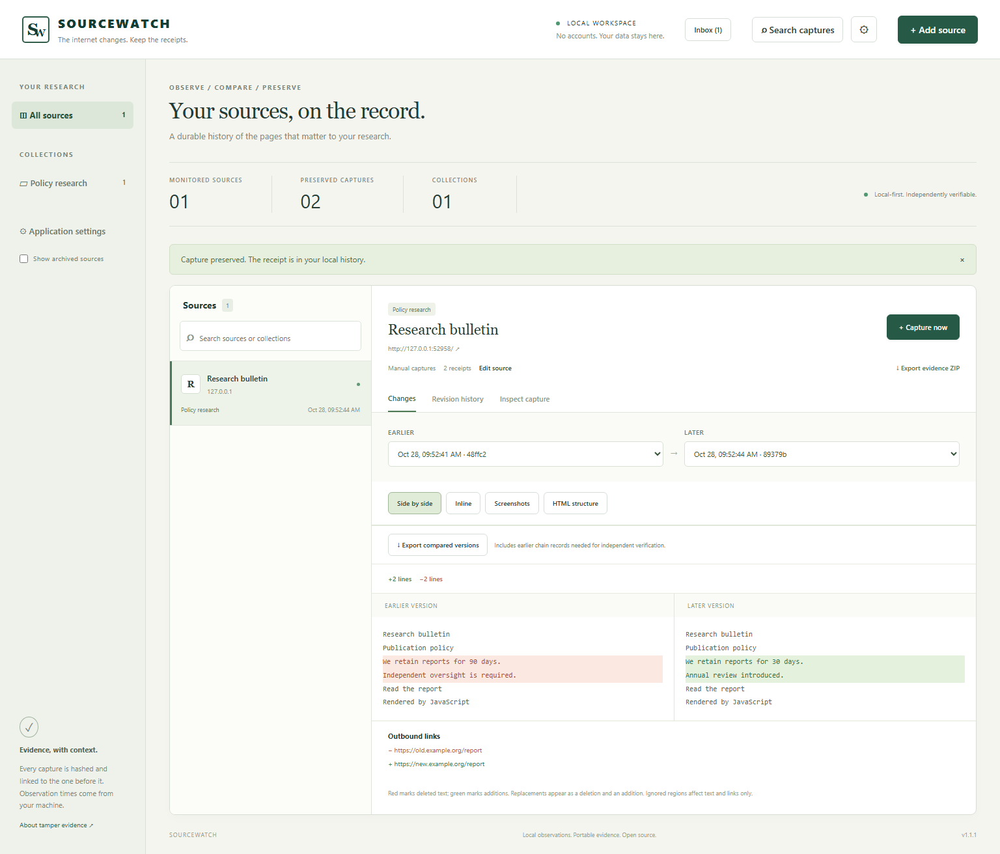

# SOURCEWATCH


**The internet changes. Keep the receipts.**

A local-first research workstation for capturing public webpages, comparing revisions, and exporting independently verifiable evidence packages. No accounts, API keys, paid services, or cloud storage are required.

SOURCEWATCH runs on your machine. It saves rendered HTML, comparison text, full-page PNG screenshots, page metadata, response headers, and a SHA-256-linked capture history in local storage.

## Run locally

Install **Node.js 24 or newer**, npm, and Git. Chromium requires supported operating-system libraries; on Linux use `npx playwright install --with-deps chromium` instead of the browser install command below.

On Windows, double-click `setup-sourcewatch.cmd`, then `start-sourcewatch.cmd`. These scripts use npm.cmd/npx.cmd and do not change PowerShell execution policy. See [Windows instructions](docs/WINDOWS.md).

From a clone or extracted source directory:

```sh
cd sourcewatch
npm ci
npx playwright install chromium
npm run build
npm start
```

Open **http://127.0.0.1:3210**. Keep the service running for scheduled captures. `npm start` serves the built UI; rerun `npm run build` after frontend changes. `npm run dev` starts the TypeScript server and also requires an existing UI build.

The default data directory is `./data`, relative to the launch directory. Use `SOURCEWATCH_DATA` to select another directory and `PORT` to change the local port. See [.env.example](.env.example); the server does not automatically load that file. No Docker installation is required.

## Capture → compare → export → verify

1. Select **Add source**, enter a public HTTP(S) URL, choose a collection, and optionally set an interval and CSS selectors for dynamic regions.
2. Select **Capture first version**. Inspect its screenshot, text, HTML download, metadata, warnings, and local observation time.
3. After the website changes, select **Capture another version**. Choose two receipts and use **Side by side** or **Inline**. Deleted text is red; additions are green. Replacements appear as a deletion and an addition. Outbound link additions and removals are listed separately.
4. Select **Export evidence ZIP** to download the source's complete history, including both versions. Save the displayed manifest SHA-256 somewhere separate from the ZIP.
5. Extract the ZIP. From the extracted directory, run:

```sh
node verify.mjs .
node verify.mjs . --expect YOUR_SEPARATELY_RETAINED_MANIFEST_SHA256
```

The verifier uses only Node.js built-ins and needs neither the application, database, npm dependencies, nor network access. It reports missing, modified, unexpected, unsafe, and hash-chain-inconsistent files. Success exits with code 0; failure exits with code 1. Run a trusted copy of `scripts/verify.mjs` when examining a bundle supplied by someone else: a verifier included in an untrusted ZIP can itself be replaced.

Hashes establish consistency with a manifest. **They do not prove website authenticity, authorship, publication time, or independently certify observation timestamps.** Someone able to rewrite a whole bundle can recompute its hashes; a separately retained manifest hash provides an external comparison point.

## What is implemented

- Public HTML page capture in isolated Playwright Chromium contexts, including JavaScript-rendered content.
- Source names/descriptions, collections, editing, archive/restore, manual capture, intervals of at least five minutes, and pause/resume scheduling while the process runs.
- Append-only database capture rows, per-artifact SHA-256 checksums, and a per-source hash chain.
- Chronological history, capture inspection, source search, and preserved-text search within a source or across all sources (up to 100 global results, including archived sources).
- Line and word comparisons, deleted-section highlighting, explicit title changes, and changed outbound links.
- CSS exclusions for comparison text and links. Original rendered HTML and screenshots retain excluded regions.
- Full-source or selected-history evidence ZIP export with JSON metadata, manifest, and standalone verifier; individual artifact downloads. Selected exports include earlier captures needed to verify the chain.
- Responsive desktop and mobile interface, local capture errors, retry through manual capture, and local application settings for the render settle delay (0–5000ms).

## Real application screenshots

These screenshots are generated by the browser integration test against a deliberately changing local research fixture. The fixture is used only through explicit test transport injection; the production app blocks local website URLs.



[Capture inspector](docs/screenshots/capture.png) · [Mobile interface](docs/screenshots/mobile.png)

## Limits and responsible use

Use the tool only where you are permitted to observe and retain the public material. Respect site terms, copyright, personal data, and reasonable request intervals. SOURCEWATCH does not bypass logins, paywalls, CAPTCHAs, or other access controls. Capturing a page does not grant permission to redistribute it.

A capture is an observation, not a complete archival replay: external assets are not separately archived, and content requiring scrolling, interaction, authentication, delayed loading, or blocked requests can be absent. Text is normalized from the rendered DOM; it is not a perfect accessibility or visual-reading representation. Inspect warnings and screenshots. Screenshot overlays support visual review; HTML element outlines support structural comparison. There is no automated screenshot pixel-difference scoring or full archival replay.

Bounds are deliberately conservative: HTTP(S) standard ports only, one capture at a time, 45-second capture deadline, 10-second request timeout, 8 MiB per response, 32 MiB response budget, 150 requests per capture, and 100,000px default screenshot height (configurable up to 200,000px). Media and font requests, WebSockets, service workers, downloads, and non-read requests are blocked. Some modern sites will render incompletely or fail. ZIP export is limited to 256 MiB of capture artifacts and is assembled in memory.

There is no destructive source/history deletion through the UI, external email/webhook notification delivery, automatic retention policy, or background operating-system service. The local change inbox retains change/failure notices. Remove a source from monitoring by archiving it; evidence is retained and the source can be restored. Pause scheduled sources when no longer needed. To remove retained data, stop the service and manage the data directory yourself after making any required backup. This intentionally removes local history; export first. Back up the entire data directory while the service is stopped.

This is a single-user loopback application with no authentication. **Do not expose it to a LAN or the internet.** Review [SECURITY.md](SECURITY.md) before use. Data is local but not encrypted; anyone with filesystem access can read captures. Do not submit URLs containing secrets in query strings. Browser contexts are fresh and do not use your normal browser's sessions.

## Development and verification

```sh
npm run lint
npm run typecheck
npm run build
npm test
npm audit --audit-level=moderate
```

The build includes TypeScript checking. Tests use Node's test runner through `tsx`, real Chromium, and an actual changing fixture server. See [testing details](docs/TESTING.md), [architecture](docs/ARCHITECTURE.md), and [contribution guidance](CONTRIBUTING.md). CI configuration is provided; a configured workflow is not evidence of a completed hosted CI run.

MIT licensed. See [LICENSE](LICENSE). Publication status and executed release checks belong in the release report; this README does not assert a published repository or release.


### Additional resource bounds

Production transport permits at most six simultaneous resource requests inside the single active capture. All resource streams share a 32 MiB byte budget; individual responses are limited to 8 MiB. Responses compressed despite an identity-encoding request are rejected to prevent decompression bombs. Rendered HTML is limited to 16 MiB after serialization. Screenshot width is limited to 4096px and total area to 160 million pixels. Screenshot height defaults to 100,000px and is configurable from 1,000 to 200,000px. The 45-second deadline begins after browser startup (startup itself has a 10-second timeout). These bounds do not replace OS-level memory/CPU isolation: hostile page scripts can still consume resources before measurement.
## Included evidence and validation

The [example bundles](examples/README.md) contain real exports from the integration fixture and a production capture of example.com. See [executed local checks](docs/VALIDATION.md) and [release/publication instructions](docs/RELEASE.md).

## Research workspace in 1.1

- Local change inbox for text/title/outbound-link changes and capture failures, with unread state and links to the exact comparison. It is not backfilled for older captures and shows the latest 500 events.
- Editable per-capture research notes and tags, searchable alongside preserved text. Notes do not alter original capture metadata or chain hashes. Evidence exports include nonempty notes for included captures in clearly labeled `research-notes.json`, covered by the export manifest. Notes themselves are not an append-only historical record.
- Saved screenshot overlay slider and inert HTML structure comparison (5,000 elements/30 levels; script/style/template content and presentation attributes excluded). Structure comparison operates on original HTML, so text exclusion selectors do not apply there.
- Taller captures: default 100,000px, configurable up to 200,000px, while retaining a 160-million-pixel area bound and 4,096px width bound. A genuine 90,016px PNG was captured in local validation.
- Windows setup/launch scripts. Existing data and original capture hashes are preserved by additive research-table migrations.

See the [staged rollout](docs/ROLLOUT.md). Full WARC/WACZ compatibility, archival replay, external notifications, and multi-user hosting remain future work.

## 1.1.1 audit patch

The local 1.1.1 candidate fixes stale capture/annotation UI state, makes source setting updates atomic, waits for an active capture during shutdown, and cleans up artifacts after failed database commits. Regression tests expand coverage of transport limits, migration, selected exports, and delayed/failed UI requests. Validation completed with 54 passing tests, zero failures, and two Windows skips (56 total), passing build/lint/type checks, zero dependency-audit vulnerabilities, and an accelerated 12-cycle soak. The soak took 28,291ms and is not a twelve-hour test. See [audit scope and limitations](docs/AUDIT.md) for details and remaining release steps. Publication remains blocked.

Playwright Chromium's OS sandbox is disabled by default. Browser contexts and the network proxy are application controls, not OS isolation. A sandbox-enabled launch could not run under the managed Windows execution environment; use an isolated VM when examining hostile pages. Chromium was validated; Firefox/Edge UI passes were not completed because of launch restrictions.
