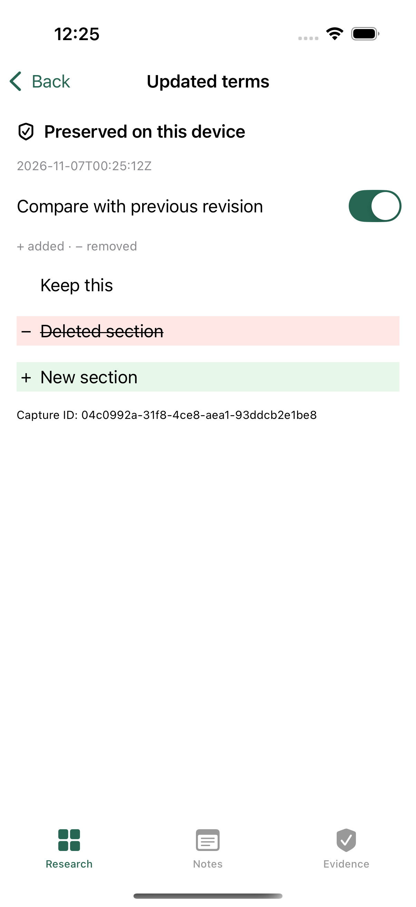

# Native iPhone preview validation

Version 0.1.0, iOS 17+, native SwiftUI/SwiftData. Built from commit `6d39502d323056cb0ede5963f042c3d8eab3dcd3` by the [successful native pipeline](https://github.com/DevCoast-web/sourcewatch/actions/runs/42317534539). Development took place on Windows; compilation and testing used GitHub's standard hosted macOS runner. No signing secrets or paid membership were used.

## Passed

- Eight XCTest core tests: SQLite source/note reopening, capture/restart/export/verification, modified/missing artifacts, receipt-chain ordering, retained manifest hashes, malformed ZIPs, input limits and independent note revisions.
- One real XCUITest workflow: create a source, paste exact evidence through the native edit menu, preserve two revisions, inspect added/deleted/unchanged text, terminate/relaunch, and reopen saved research. Evidence/Markdown editors disable autocorrection. Keyboard-driven test input had proved intermittent, so the test validates exact pasted text before saving. The screenshot is an actual simulator capture.
- Eight independent Python verifier tests, plus verification of an evidence ZIP produced by Swift in the simulator. The exported two-capture fixture returned `ok: true`, with zero errors.
- Release device build and IPA packaging. Independently checked IPA ZIP CRCs, ARM64 executable, iPhoneOS platform, minimum iOS 17.0, bundle ID `org.sourcewatch.mobile`, app icon, absent provisioning profile, and SHA-256 matching the workflow checksum.
- Existing desktop/browser CI remained green for the implementation changes.

IPA SHA-256: `98318478c6db0831fde1ce2b46df6abdd82f7cd57fd709dfe718f943501eacc7` (267,025 bytes).

## Limits

Physical iPhone installation and renewal with AltStore have **not** been tested on the user's device. The IPA is unsigned and cannot install itself. Free personal signing needs periodic renewal and has capability limits. This is not permanent provisioning or App Store approval. The device build emits an iPad orientation warning; only the iPhone portrait workflow is covered here.

Direct website capture, scheduled monitoring, Graph/Canvas, desktop database migration and whole-library backup/restore are not present in this preview. See `ios/INSTALL.md` and `ios/ARCHITECTURE.md`. Imported artifacts/pasted text are labeled as researcher-supplied evidence. Hashes do not establish website authenticity or independently certified timestamps. SourceWatch does not receive Apple credentials.

